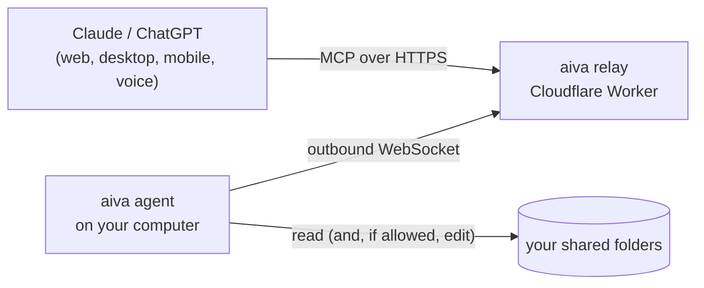

<div align="center">

# aiva

**Talk to your AI about the code on your computer, from anywhere.**

Ask Claude about your project from your phone, out loud, while you're away from your desk.<br>
aiva gives Claude, ChatGPT and other MCP apps careful access to the folders you choose.

```bash
curl -fsSL https://aiva.prajwalshete.com/install.sh | sh
```

[How it works](#how-it-works) · [Tools](#what-your-ai-can-do) · [Safety](#safety-model) · [CLI](#cli) · [Self-hosting](#run-your-own-relay) · [Development](#development)

</div>

---

## Why

Coding agents are great at your desk. aiva is for everywhere else: on a walk, in a meeting, on the couch.

- **Ask about your code from any Claude app**, including voice mode on your phone. "How does checkout work in my food app?" gets an answer built from your real code, not a guess.
- **Nothing to sign up for.** Your computer generates its own key. The server stores nothing.
- **Read-only by default.** Editing is opt-in per folder, and every change can be undone.
- **Fast.** The agent is a single Rust binary. Most tool calls finish in a few milliseconds on your machine.

## Quick start

**1. Install** (macOS or Linux):

```bash
curl -fsSL https://aiva.prajwalshete.com/install.sh | sh
```

The installer starts `aiva setup`. Pick the folders to share. Setup installs a background service and prints two things:

```
  URL    https://aiva.prajwalshete.com/3f9c2a71d0e84b6c5a12/mcp
  Token  aiva_…
```

**2. Add the URL as a custom connector.** In Claude: *Settings → Connectors → Add custom connector*. ChatGPT, Cursor and Claude Code work the same way.

**3. Click Connect and paste the token** on the page that opens. That's it. Try asking:

> *"Use aiva to give me an overview of my project, then explain how the API is structured."*

Lost the token? Run `aiva token`.

## How it works



- **Your computer connects out.** The agent opens one outbound WebSocket to the relay. No open ports, tunnels or router settings.
- **The relay only passes traffic along.** A Cloudflare Worker receives MCP requests from your AI app. A Durable Object, one per computer, holds that computer's connection and forwards each tool call to it. Nothing is stored. Idle connections hibernate and cost nothing.
- **Identity without accounts.** `aiva setup` generates a random key on your machine. Your connector URL is derived from a hash of that key. Connecting an app means proving you hold the key, by pasting it once.
- **Standard OAuth for the apps.** Apps go through the normal MCP sign-in (discovery, dynamic client registration, PKCE). Every client registration, code and token is a short HMAC-signed value, so the relay keeps no database. `aiva rotate` creates a new key and URL, which disconnects every app at once.

## What your AI can do

Reading tools are marked read-only, so apps run them in parallel.

| Tool | What it does |
| --- | --- |
| `project_overview` | One-call orientation: languages, manifests (scripts, dependencies), entry points, git state, README, folder tree, and a ranked map of the most-used functions and classes |
| `list_folders` | The shared folders and whether each allows edits |
| `list_dir` | Folder tree that respects `.gitignore` |
| `find_files` | Glob or fuzzy name search, newest first |
| `search` | ripgrep's engine with regex or literal matching, glob/type filters, context lines, and content/files/count modes |
| `read_files` | Up to 20 files or line ranges in one call, numbered |
| `outline` | Functions, classes and methods with line ranges, for a file or a whole folder |
| `find_symbol` | Where something is defined (`AuthService/login`), optionally with its source |
| `find_references` | Every use of a name, labeled with the function it sits in |
| `git` | status, log, diff, show, blame |
| `run` | Read-only command lines with pipes: `rg -n TODO src \| wc -l`, `sed -n '120,180p' app.ts`, `jq '.scripts' package.json` |

Symbol parsing uses tree-sitter for TypeScript/TSX, JavaScript, Python, Rust, Go and Java. Other languages get keyword-based outlines.

### Editing (opt-in per folder)

```bash
aiva folders set myapp write
```

That folder then also gets:

| Tool | What it does |
| --- | --- |
| `edit_file` | Replace `old_string` with `new_string`, or apply a batch of edits all-or-nothing. An empty `old_string` creates a file |
| `write_file` | Create a file, or replace a whole file the AI has fully read |
| `undo_change` | Revert the latest change, the latest change to a file, or a specific change |

Edits are built to succeed on the first try and to never do quiet damage:

- **Tolerant matching, strict about ambiguity.** A match is tried exact first, then with normalized quotes, dashes and odd spaces, then ignoring trailing whitespace, then with a uniform indentation shift (the new text is re-indented to fit). It also tolerates line numbers copied from read output and over-escaped text. Each step must find exactly one place, and fuzzy similarity is never used to apply an edit.
- **Helpful misses.** When nothing matches, the AI is shown the closest real text with line numbers and what differs.
- **No lazy placeholders.** `// ... existing code ...` is rejected, because text is written literally and a placeholder would delete code.
- **Your editor wins.** If you changed a file after the AI read it, only exact edits apply. A whole-file rewrite requires a fresh full read.
- **Every change is backed up before it's written.** Revert with `aiva undo` or by asking. Undo refuses if the file changed afterwards, so newer work is never lost.
- **Checks on the result.** New syntax errors are reported straight back so the AI fixes them, and edits that would break valid JSON are refused.
- **Safe writes.** Writes are atomic and keep permissions, line endings (including CRLF), byte-order marks and hard links.
- **Retries are safe.** If the app retries a call, the change isn't applied twice.

Your AI app asks before each edit by default (a tap, also in voice mode). You can switch edit tools to "Always allow" in the app's connector settings.

## Safety model

| Layer | Guarantee |
| --- | --- |
| Folders | Only folders you add. Paths are resolved after following symlinks, so `..` and links pointing outside are refused. |
| Secrets | `.env*` (except `.env.example`), keys and certificates, `.ssh/`, `.aws/`, `.npmrc`, `.netrc` and Terraform state are never listed, searched, read or written. This includes git history and `run` commands. Add your own patterns under `"blocked"` in `~/.aiva/config.json`. |
| Read-only by default | Edit tools don't exist for an app until you allow edits in a folder. |
| `run` | No shell. Only allowlisted read-only programs, with `;`, `&&`, `>`, `$(…)` and backticks refused. Flags that write or execute (`sed -i`, `awk system()`, `find -exec/-delete`, `rg --pre`, `git commit`…) are refused, and so is following links out of the folder. |
| Git | Hooks, pagers, external diff tools and fsmonitor are disabled for every git command aiva runs. |
| Protected files | `.git` internals, git hooks, `.envrc` and AI-tool configs (`.claude/`, `.mcp.json`, `.cursor/`) can't be edited. |
| Access | Only someone with your token can connect an app to your URL. `aiva rotate` cuts off every app. The relay stores nothing. |

On macOS, a background process may need permission for Documents/Desktop. `aiva doctor` tells you if so: allow `aiva` under *System Settings → Privacy & Security → Full Disk Access*.

## Performance

Measured on a real 488-file TypeScript project, with the relay in Singapore and the computer in India:

| Part of a tool call | Time |
| --- | --- |
| Tool on your computer (`list_folders`, `read_files`) | 1–2 ms |
| Tool on your computer (`search`, `find_symbol`) | 30–38 ms |
| Tool on your computer (`project_overview`) | 130–220 ms |
| Agent overhead | 0.2 ms |
| Worker | < 1 ms |
| Worker → Durable Object | 7–8 ms |
| Network to your computer and back | 90–100 ms |

Every MCP response carries a `Server-Timing` header with this breakdown, and the relay logs one line per call.

## CLI

```text
aiva setup                        choose folders, start the service, show the URL and token
aiva token                        show the connector URL and token again
aiva rotate                       new token and URL (disconnects every app)
aiva status [--json]              URL, online state, service, folders
aiva doctor                       check everything and explain how to fix problems

aiva folders [list]               shared folders and their access
aiva folders add <path>… [--write]
aiva folders remove <name|path>…
aiva folders set <name> read|write

aiva start | stop | restart       control the background service
aiva service install|uninstall|status
aiva logs [-n 50] [-f]            each call, with tool time and agent time

aiva history [-n 20]              changes your AI made
aiva undo [id]                    revert the latest change (or a specific one)

aiva tools                        tools your AI sees right now
aiva call <tool> '<json>'         run a tool locally, exactly as the AI would
aiva url | config | update | uninstall
```

The background service is a launchd agent on macOS and a systemd user unit on Linux. It starts at login and restarts if it stops. Folder changes take effect immediately.

## Run your own relay

The relay is one Cloudflare Worker with a Durable Object binding. It runs on the free plan and needs no database, storage bucket or KV.

```bash
cd relay
npm install
openssl rand -base64 48 | npx wrangler secret put SIGNING_KEY   # changing it later disconnects all apps
# set PUBLIC_ORIGIN, routes and RELEASES_URL in wrangler.jsonc, then:
npx wrangler deploy
```

Point the agent at it with `aiva setup --server https://your-domain` (or `AIVA_SERVER`).

## Development

```
agent/   Rust CLI and agent. Tools live in agent/src/tools/, one file per family
relay/   Cloudflare Worker: stateless OAuth, MCP endpoint, AgentHub Durable Object
.github/workflows/release.yml   builds macOS and Linux binaries for version tags
```

```bash
# agent
cd agent && cargo build && cargo test
AIVA_HOME=/tmp/aiva-dev ./target/debug/aiva folders add ~/code/myapp
AIVA_HOME=/tmp/aiva-dev ./target/debug/aiva call project_overview '{}'

# relay (wrangler simulates the Durable Object locally)
cd relay && npm install && cp .dev.vars.example .dev.vars
npm run dev                                   # http://localhost:8787
AIVA_SERVER=http://127.0.0.1:8787 AIVA_HOME=/tmp/aiva-dev ../agent/target/debug/aiva setup
```

**Adding a tool:** implement the `Tool` trait in `agent/src/tools/` and add it to `registry()` in `tools/mod.rs`. The relay needs no changes; it asks the agent for its tool list live. Set `read_only()` to `false` for anything that changes files, and it will only be offered for folders that allow edits.

**Releasing:** push a tag like `v0.3.0`. The workflow builds `aiva-darwin-arm64`, `aiva-darwin-x64`, `aiva-linux-x64` and `aiva-linux-arm64` with checksums, which `install.sh` downloads through `/dl/<version>/<asset>`.

## Roadmap

- Background index with a file watcher, so search and symbol lookups answer from memory
- `map_features`: every HTTP route, screen route and database table in one call
- Batch `find_symbol`, and `read_files` by symbol name
- Sandboxed `shell` (tests, builds), opt-in per folder
- Move, rename and delete-to-trash tools
- Windows service, signed binaries, Homebrew
